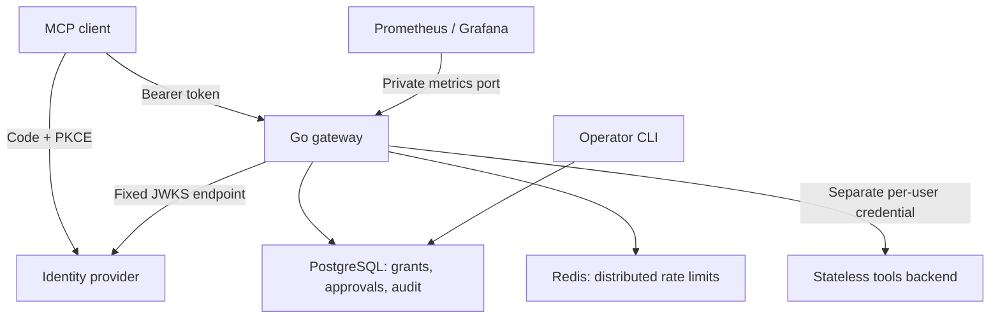

# Architecture

## Request path

1. Reject queries and unapproved browser Origins. Authenticate every request.
2. Validate RS256 signature, fixed issuer, gateway audience, expiry, optional
   not-before/issued-at and nonempty subject. Load signing keys from a configured
   JWKS URL, never from a token-supplied URL. Refresh at most once per minute.
3. Apply a Redis fixed-window per-subject rate limit shared by all replicas.
4. Require `mcp:connect`. Bound bodies to 1 MiB and reject ambiguous duplicate JSON
   keys, batches, invalid IDs, unsupported versions and unknown methods.
5. For tool calls, intersect configured tool allowlist, token scope and exact
   `(subject, tool)` PostgreSQL grant. Tool listings use the same intersection.
6. For sensitive tools, atomically consume a five-minute approval bound to the
   subject and canonical hash of the entire params object.
7. Persist an authorization intent before any upstream call. Database failures
   fail closed. Use a separate subject-specific upstream credential.
8. Forward to the fixed operator-configured endpoint with a fresh header set.
   Do not follow redirects. Propagate HTTP cancellation and bound execution to 15s.
9. Accept bounded JSON responses only, validate envelope and response ID, filter
   discovery, then append a completion event. A completion audit failure is logged
   and counted; it cannot undo a completed action.

## State and identity

The gateway terminates the client initialization handshake and reports only the
capabilities it implements. It issues no session identifiers and forwards no
sessions. Its downstream contract is a JSON-only stateless tools endpoint that
accepts `tools/list` and `tools/call` without a persistent handshake. The included
demo server implements that contract. Arbitrary stateful MCP servers are **not**
drop-in replacements.

One configured issuer is supported. Credentials are mapped to its immutable `sub`
values through environment-variable names in configuration. No request can choose
its upstream URL, override a credential mapping, or supply another user's identity.
Provision and rotate these secrets externally; this project does not implement
an upstream OAuth account-linking or token-exchange service.

## Approval semantics

`admin approve` produces 32 random bytes encoded as hex. Only its SHA-256 hash is
stored. The DELETE predicate checks hash, subject, params digest and expiration in
one atomic database statement. It cannot be replayed, even across gateway replicas.
Keys are sorted for hashing; JSON numbers retain precision. Semantically equivalent
numeric spellings can hash differently, intentionally favoring exact approval.
The token is consumed before execution. Failed requests require a fresh approval.
There is no automated retry of tool calls and no exactly-once execution guarantee.

## Why PostgreSQL and Redis

PostgreSQL is the source of truth for policy and approval decisions, while Redis
holds short-lived rate-limit counters. Policies are read on every call: changes
apply without a gateway restart. A policy revoked after a call is authorized does
not cancel that already-running call. Fixed windows can permit up to twice the
configured limit across a minute boundary; this is not a token-bucket limiter.
